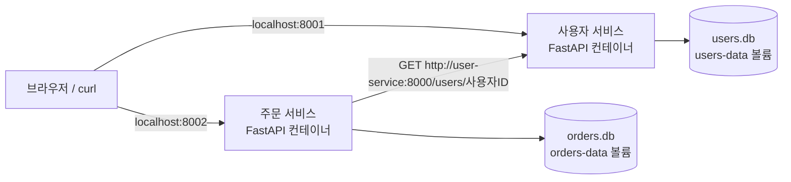

# FastAPI MSA 백엔드 과제

사용자를 등록하고 해당 사용자의 주문을 생성하는 작은 백엔드입니다. 사용자와 주문을 각각 독립적인 FastAPI 서버로 분리했습니다.

## 과제 조건 충족

| 조건 | 구현 |
| --- | --- |
| Python 3.10 이상 | Docker 이미지에서 Python 3.12 사용 |
| FastAPI 사용 | 사용자 서비스와 주문 서비스 각각 FastAPI로 구현 |
| Docker로 구현 | 서비스별 Dockerfile + Docker Compose |
| MSA 방식 | 업무별 서버·DB 분리, 서비스 간 HTTP 통신 |

## 1. 실행하기

Docker와 Docker Compose가 필요합니다. Windows/macOS에서는 Docker Desktop을 설치하고 실행해 주세요. 첫 빌드는 이미지와 패키지를 다운로드하므로 인터넷 연결이 필요합니다.

이 README와 `compose.yaml`이 있는 `fastapi-msa` 폴더에서 실행합니다.

```bash
docker compose up --build -d --wait
docker compose ps
```

두 서비스가 `healthy` 상태가 되면 실행이 완료된 것입니다. `--wait`를 지원하지 않는 구형 Compose에서는 `docker compose up --build -d`를 실행한 뒤 `docker compose ps`로 상태를 확인하세요.

| 서비스 | 주소 | Swagger API 문서 |
| --- | --- | --- |
| 사용자 | http://localhost:8001 | http://localhost:8001/docs |
| 주문 | http://localhost:8002 | http://localhost:8002/docs |

Swagger에서 API를 선택한 뒤 **Try it out → Execute**를 누르면 별도 프로그램 없이 요청을 보낼 수 있습니다. 두 서비스의 `/health`에서도 상태를 확인할 수 있습니다.

## 2. 사용자 등록 → 주문 생성

**사용자 등록**: 사용자 Swagger의 `POST /users`에서 아래 JSON을 보냅니다.

```json
{
  "name": "홍길동",
  "email": "hong@example.com"
}
```

성공하면 `201 Created`와 함께 사용자 `id`가 반환됩니다. **다음 주문 요청의 `user_id`에는 이 값을 넣으세요.** 같은 이메일을 다시 등록하면 `409`가 반환됩니다.

**주문 생성**: 주문 Swagger의 `POST /orders`에서 아래 JSON을 보냅니다. 여기서는 반환된 사용자 ID가 `1`이라고 가정합니다.

```json
{
  "user_id": 1,
  "product_name": "파이썬 교재",
  "quantity": 2,
  "unit_price": 15000
}
```

성공 응답 예시입니다. 시간은 UTC로 저장하며, 총액은 서버에서 `수량 × 단가`로 계산합니다. 금액 단위는 원이며 정수만 받습니다.

```json
{
  "id": 1,
  "user_id": 1,
  "product_name": "파이썬 교재",
  "quantity": 2,
  "unit_price": 15000,
  "total_price": 30000,
  "created_at": "2026-10-01T00:00:00Z"
}
```

터미널에서도 실행할 수 있습니다. 아래 명령은 macOS/Linux 또는 Git Bash 기준입니다.

```bash
curl -X POST http://localhost:8001/users \
  -H 'Content-Type: application/json' \
  -d '{"name":"홍길동","email":"hong@example.com"}'

# user_id는 위 응답의 id로 바꾸세요.
curl -X POST http://localhost:8002/orders \
  -H 'Content-Type: application/json' \
  -d '{"user_id":1,"product_name":"파이썬 교재","quantity":2,"unit_price":15000}'

curl http://localhost:8001/users
curl 'http://localhost:8002/orders?user_id=1'
```

## 3. MSA 구조 이해하기



**MSA(Microservices Architecture)**는 업무 책임을 작은 서비스들로 나누는 구조입니다. 이 프로젝트에서는 사용자 서비스가 사용자 정보만 관리하고, 주문 서비스가 주문 정보만 관리합니다. 두 서비스는 서로 다른 Python 프로세스와 컨테이너에서 실행되며, 각자의 SQLite DB와 Docker 볼륨을 소유합니다. 다른 서비스의 DB를 직접 조회하지 않습니다.

주문 생성 흐름은 다음과 같습니다.

1. 클라이언트가 주문 서비스에 `POST /orders`를 보냅니다.
2. 주문 서비스가 사용자 서비스의 `GET /users/{user_id}`를 HTTP로 호출합니다.
3. 사용자가 있으면 주문 서비스가 총액을 계산하고 자신의 DB에 저장합니다.
4. 주문 서비스가 생성된 주문을 클라이언트에게 반환합니다.

Compose 네트워크 안에서는 `user-service`라는 서비스 이름으로 사용자 서버에 접근합니다. **컨테이너 안의 `localhost`는 해당 컨테이너 자신**을 뜻하므로, 다른 서비스 호출에는 `http://user-service:8000`을 사용합니다. 호스트에서 보이는 포트는 각각 8001과 8002지만, 컨테이너 내부 포트는 둘 다 8000입니다.

사용자 서버를 호출할 때 각 네트워크 작업의 타임아웃은 3초입니다. 사용자 서버가 중단되면 새 주문은 `503`으로 실패하지만, 이미 저장된 주문 조회는 계속 가능합니다. `/health`는 해당 서비스와 자체 DB의 상태를 확인합니다. Compose는 사용자 서비스가 처음 `healthy`가 된 뒤 주문 서비스를 시작하도록 설정했습니다. 이는 최초 시작 순서이며, 실행 중의 장애 처리는 주문 API에서 별도로 수행합니다. [Docker 시작 순서 문서](https://docs.docker.com/compose/how-tos/startup-order/)

각 서비스 폴더만으로 Docker 이미지를 만들 수 있어 독립적으로 배포할 수 있습니다. 예를 들어 사용자 서비스 코드 변경 후 다음 명령으로 사용자 서비스만 다시 빌드할 수 있습니다.

```bash
docker compose up -d --build --no-deps user-service
```

## 4. API 목록

| 서비스 | 메서드 | 경로 | 설명 |
| --- | --- | --- | --- |
| 사용자 | GET | `/health` | 사용자 서버와 DB 상태 |
| 사용자 | POST | `/users` | 사용자 등록 |
| 사용자 | GET | `/users` | 사용자 목록 |
| 사용자 | GET | `/users/{user_id}` | 사용자 단건 조회 |
| 주문 | GET | `/health` | 주문 서버와 자체 DB 상태 |
| 주문 | POST | `/orders` | 사용자 확인 후 주문 생성 |
| 주문 | GET | `/orders` | 주문 목록, `user_id`로 필터 가능 |
| 주문 | GET | `/orders/{order_id}` | 주문 단건 조회 |

목록 API는 `offset`과 `limit`를 지원합니다. 기본 `offset=0`, `limit=20`이며 `limit`의 최대값은 100입니다. 예: `/users?offset=20&limit=20`.

| 응답 코드 | 의미 |
| --- | --- |
| 200 | 조회 성공 |
| 201 | 등록·생성 성공 |
| 404 | 사용자 또는 주문 없음 |
| 409 | 중복 이메일 |
| 422 | 잘못된 JSON, 이메일, 수량, 금액, ID 또는 허용되지 않은 필드 |
| 503 | 주문 생성 중 사용자 서버 연결 실패·비정상 응답 또는 상태 확인 중 DB 오류 |

이메일은 소문자로 저장하여 대소문자를 구분하지 않습니다. 사용자 이름은 1~100자, 상품명은 1~200자이며, 공백만 있는 값은 거부합니다. 주문 수량은 1~1000, 단가는 1~1,000,000,000입니다. `total_price`는 요청에 넣지 않습니다.

## 5. 테스트

### 실행 중인 Docker 서버 확인

호스트에 Python을 설치하지 않아도 주문 컨테이너의 Python으로 두 서버를 확인할 수 있습니다. 프로젝트 루트에서 실행하세요.

```bash
docker compose exec -T order-service python - \
  --user-url http://user-service:8000 \
  --order-url http://127.0.0.1:8000 < scripts/smoke_test.py
```

또는 호스트에 Python 3.10 이상이 있으면 다음 명령을 사용합니다. 추가 Python 패키지는 필요하지 않습니다.

```bash
python3 scripts/smoke_test.py
```

이 검사는 사용자 등록·조회, 주문 생성·조회, 총액 계산, 중복 이메일, 입력 검증을 실제 HTTP로 확인합니다. 실행할 때마다 고유한 테스트 사용자와 주문을 하나씩 남깁니다. 포트를 변경했다면 `--user-url`과 `--order-url` 옵션으로 주소를 지정하세요.

### 자동 테스트

Python **3.12를 권장**합니다. 아래 명령은 프로젝트 루트에서 실행하며, Docker 실행 없이 임시 DB를 사용합니다.

먼저 `python3 --version`으로 3.10 이상인지 확인하세요. 기존 `python3`가 3.9 이하라면 3.12를 설치하고 가상환경 생성 명령의 `python3`를 `python3.12`로 바꿉니다.

```bash
python3 -m venv .venv
source .venv/bin/activate
python -m pip install -r requirements-dev.txt
python -m pytest -q
```

Windows PowerShell에서는 가상환경 활성화 명령 대신 `.venv\Scripts\python.exe -m pip install -r requirements-dev.txt`, `.venv\Scripts\python.exe -m pytest -q`를 사용할 수 있습니다.

정상 요청 외에도 입력 검증, 존재하지 않는 사용자, 중복 이메일, 페이지 조회, 타임아웃·연결 실패·비정상 응답, 앱 재시작 후 데이터 보존을 확인합니다.

### 장애 동작 직접 확인

먼저 주문을 하나 생성한 뒤 실행합니다.

```bash
docker compose stop user-service
curl http://localhost:8002/orders
```

기존 주문 조회는 성공합니다. 이 상태에서 `POST /orders`를 보내면 `503`이 반환됩니다. 아래 명령으로 사용자 서비스를 복구한 뒤 `docker compose ps`에서 `healthy` 상태를 확인하세요.

```bash
docker compose start user-service
docker compose ps
```

## 6. 로그, 종료, 데이터

```bash
# 로그 확인
docker compose logs -f

# 서버 종료: 데이터 볼륨은 유지됩니다.
docker compose down

# 다시 실행: 기존 사용자와 주문이 유지됩니다.
docker compose up -d --wait
```

DB는 서비스별 이름 있는 볼륨에 저장됩니다. 컨테이너를 재시작하거나 다시 만들어도 데이터를 보존합니다. **모든 사용자와 주문을 삭제하고 초기화하려는 경우에만** `docker compose down -v`를 사용하세요.

포트가 사용 중이면 `.env.example`을 `.env`로 복사하고 `USER_SERVICE_PORT`, `ORDER_SERVICE_PORT`를 바꾼 뒤 다시 실행합니다. `Cannot connect to the Docker daemon` 메시지가 나오면 Docker Desktop 또는 Docker 엔진의 실행 상태를 확인하세요.

## 7. 파일 구조

```text
fastapi-msa/
├── compose.yaml                  # 두 컨테이너, 네트워크, 볼륨, 상태 검사
├── .env.example                  # 호스트 포트 설정 예시
├── requirements-dev.in           # 개발 의존성 정의
├── requirements-dev.txt          # 개발·테스트 의존성 버전 고정
├── pytest.ini
├── services/
│   ├── user_service/
│   │   ├── Dockerfile
│   │   ├── .dockerignore
│   │   ├── requirements.in       # 직접 사용하는 패키지
│   │   ├── requirements.txt      # 전체 의존성 버전 고정
│   │   └── app/
│   │       ├── __init__.py
│   │       ├── main.py           # API와 앱 시작 처리
│   │       ├── schemas.py        # 요청·응답 형식과 검증
│   │       └── database.py       # 사용자 저장소
│   └── order_service/
│       ├── Dockerfile
│       ├── .dockerignore
│       ├── requirements.in
│       ├── requirements.txt
│       └── app/
│           ├── __init__.py
│           ├── main.py           # API와 사용자 서버 호출
│           ├── schemas.py
│           └── database.py       # 주문 저장소
├── scripts/smoke_test.py          # 실제 HTTP 실행 확인
├── tests/                        # 자동 테스트
└── README.md
```

## 8. Docker 없이 개발하기

자동 테스트 절차로 가상환경과 의존성을 준비한 뒤, 프로젝트 루트에서 터미널 두 개를 열고 각각 실행합니다. 각 터미널에서 가상환경을 활성화해 주세요. Docker 서버와 동시에 실행하면 기본 포트가 겹치므로 Docker 서버를 먼저 종료하세요.

```bash
# 터미널 1 (macOS/Linux)
DATABASE_PATH=data/users.db python -m uvicorn services.user_service.app.main:app --port 8001 --reload
```

```bash
# 터미널 2 (macOS/Linux)
DATABASE_PATH=data/orders.db USER_SERVICE_URL=http://127.0.0.1:8001 \
  python -m uvicorn services.order_service.app.main:app --port 8002 --reload
```

## 9. 제출할 때 설명할 내용

> Python 3.12와 FastAPI를 사용해 사용자 서비스와 주문 서비스를 만들었습니다. 각 서비스는 별도의 Docker 컨테이너와 SQLite DB를 사용합니다. 주문 서비스는 사용자 DB에 직접 접근하지 않고 HTTP API로 사용자를 확인합니다. Docker Compose로 두 서비스를 실행할 수 있으며, Swagger에서 API를 확인할 수 있습니다.

학습 범위는 사용자 등록·조회와 주문 생성·조회입니다. 인증·권한 관리와 실제 결제·상품 가격 검증은 포함하지 않으며, 단가는 요청에서 받습니다. SQLite는 작은 단일 인스턴스 실습용으로 선택했습니다. 운영 규모로 확장할 때는 서비스별 DB 서버, 인증, 요청 추적 등을 추가할 수 있습니다.

## 제작 시 검증 결과

Python 3.12에서 자동 테스트 **25개 통과**, 실제 두 서버 간 HTTP 통신, 사용자 서버 중단 시 처리, 재시작 후 데이터 보존, API 문서 응답을 확인했습니다. Compose 설정 검사도 통과했습니다. 제작 환경에는 실행 가능한 Docker 엔진이 없어 이미지 빌드와 컨테이너 실행은 검증하지 못했습니다. 자세한 범위는 [검증 결과](TEST_RESULTS.md)에 기록했습니다.

## 공식 참고 문서

- [FastAPI Docker 배포](https://fastapi.tiangolo.com/deployment/docker/)
- [FastAPI lifespan: 시작과 종료 처리](https://fastapi.tiangolo.com/advanced/events/)
- [Docker Compose 서비스 시작 순서](https://docs.docker.com/compose/how-tos/startup-order/)
- [HTTPX 비동기 클라이언트](https://www.python-httpx.org/async/)
